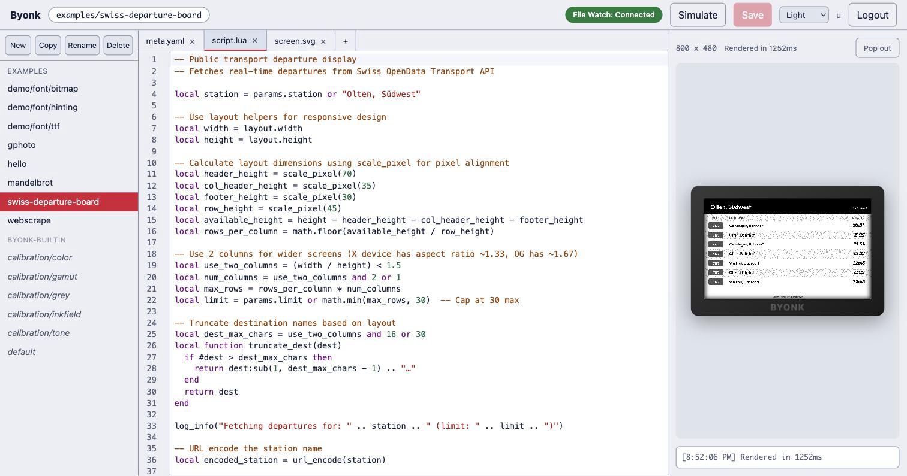

# Dev Mode

Dev mode is Byonk's built-in screen editor: a web page with three toggleable
panels — Library, Edit and Preview — behind an icon rail on the left. Pick a
screen to write, a panel profile to calibrate, or a device to configure; edit
it; and watch the rendered result next to it. It also carries the display
calibration tools: dither algorithm, tuning numbers and measured colours.

It is part of the normal server. There is no separate command to start: `byonk
serve` mounts it, behind a login, at `/dev/`.



## Opening the editor

### Set a username and password

The editor is invisible until you give it credentials. With none configured,
the editor page and its login form both answer `404 Not Found`, so a server
that was never meant to be edited over the web does not offer a login to guess
at. (The JSON API under `/dev/api/` answers `401` rather than `404` in that
case.)

Set both halves, in any one of these places:

| Where | Keys |
|-------|------|
| Environment | `BYONK_DEV_USERNAME`, `BYONK_DEV_PASSWORD` |
| `config.yaml` | `admin.dev_username`, `admin.dev_password` |
| Home Assistant app | the **Dev UI username** / **Dev UI password** options |

```yaml
admin:
  dev_username: tobi
  dev_password: a-long-random-string
```

The environment wins over `config.yaml`, exactly as `BYONK_ADMIN_TOKEN` does.
Both halves are required and a blank value counts as unset, so setting only a
username leaves the login disabled.

### Log in

Open `http://<host>:3000/dev/` in a browser and the login form appears. A bare
`http://<host>:3000/dev` is redirected to the same place.

A successful login sets a `byonk_dev` session cookie — `HttpOnly`, scoped to
`/dev`, good for 30 days. The key that signs it is generated fresh each time
the server starts, so restarting Byonk logs everyone out. A wrong username or
password is answered after a one-second delay, and the message never says
which of the two was wrong.

A **Logout** button sits at the foot of the icon rail, next to the theme
control, whenever there is a cookie session to end — click it (or `POST
/dev/logout` yourself, if you want to script it) to clear the `byonk_dev`
cookie and return to the login form. The two routes below are not sessions to
end, and the button does not appear for either of them: signing in through
Home Assistant or the admin token has nothing for it to log out of.

### The admin token also works

Any request carrying the admin token as a bearer credential is admitted
without a login:

```
Authorization: Bearer <your admin token>
```

That is what lets a script or an MCP client reach `/dev/api/*` directly. See
[Admin API](../api/admin-api.md) for where the token comes from.

### From the Home Assistant sidebar

The Home Assistant app publishes the editor as an Ingress panel: a **Byonk**
entry in the sidebar opens it directly, with no second login. Home Assistant
has already authenticated you, and the app trusts that route only for requests
arriving from the Supervisor itself.

Inside Home Assistant you therefore need no dev username or password at all.
Set them only if you also want to reach the editor from outside Home
Assistant, on `http://<host>:3000/dev/`.

## The three panels

An icon rail on the left carries one toggle button per panel: **Library**,
**Edit** and **Preview**. Click an icon to show or hide that panel — every
combination is allowed, including all three hidden at once. A panel you hide
comes back at the size it had, and the splitters between open panels keep
their position, both remembered between visits (the theme control described in
[Colour scheme](#colour-scheme), and Logout when a cookie session is open,
both live at the foot of the same rail).

Everything in the work area is about one **subject**: a screen, a panel
profile or a device. You choose it in Library; Edit changes it and Preview
shows it.

**Library.** Screens grouped by screen repo handle, then the panel profiles,
then the devices. Choosing an entry makes it the subject. A repo you cannot
write to is labelled "read-only" next to its handle; you can still open any
of its screens and read every file, and **Copy** one into a repo you can
write to — but its files open read-only. **New**, **Copy**, **Rename** and
**Delete** work on screens; see [New, Copy, Rename,
Delete](#new-copy-rename-delete).

**Edit.** The header names the subject. For a screen it is the file editor:
one tab per file, with `meta.yaml`, `script.lua` and `screen.svg` first and
everything else after them alphabetically. **Save** and Cmd/Ctrl-S write the
file you are in; see [Editing and saving](#editing-and-saving). For a panel
or a device it is the [config editor](#the-config-editor).

**Preview.** Always what is rendered. The header says which screen is shown
as which hardware, and at which size. The controls depend on the subject:

- With a screen as subject, a **Render as** menu picks a panel or a device to
  render it as.
- With a panel as subject, a **Screen** menu picks the screen to show on it
  (it starts at `byonk-builtin/calibration/tone` and remembers your later
  choice until you reload the page), and **watch on** picks a device to
  render as, so the preview matches the display you are looking at.
- **show measured inks** shows the panel's measured colours instead of the
  official palette.
- **Pop out** opens the preview in its own window, see [Preview and
  pop-out](#preview-and-pop-out).
- **Simulated inputs** is a row under the image that opens the device context
  the preview renders under: battery, WiFi, the clock, and custom params
  (not when the subject is a device, which brings its own params). While
  anything is set, it carries a "not saved" badge.

The Preview panel never writes anything. Choosing a device to watch, a screen
to borrow or a simulated battery level changes what you see and nothing else.

## Which repos you can edit

Writability is a property of where a screen repo's files live, not of its
name. `local` (your `SCREENS_DIR`), `examples`, and any repo registered with
`path:` are backed by directories Byonk manages and are editable in place. The
embedded `byonk-builtin` screens and any repo fetched from git with `repo:`
are read-only — a fetch can replace a git checkout wholesale, so edits there
would not survive. The full picture is in
[Screen Authoring](authoring.md#what-makes-a-repo-writable).

In the Home Assistant app only `local` and `examples` are writable: the app's
Screen repos option accepts `repo:` rows only.

## Editing and saving

Type in any file of a screen that lives in a writable repo. Its tab shows a
dirty marker until the bytes reach disk.

- **Cmd/Ctrl-S** saves the file you are in.
- The **Save** button next to the tabs does the same thing: it saves the
  active file, not every file you have changed. Switch to a tab and save it
  to save it.

In a read-only repo the files open read-only: you cannot type in them at all.
Cmd/Ctrl-S still fires there, and is answered with a message naming the repo
rather than failing in silence. To change such a screen, **Copy** it into a
writable repo and edit the copy.

### Conflict detection

Every save carries the etag the file had when you opened it. If the file
changed underneath you — another browser tab, an editor on the server, a git
fetch — the write is refused and a banner offers two ways out:

- **Reload** throws your edits away and takes the version on disk.
- **Overwrite** re-reads the file only to take its current etag, then writes
  your buffer over it.

The same banner appears when the file watcher reports a change to a file you
have unsaved edits in — Byonk never silently replaces a buffer you are still
working on.

### New, Copy, Rename, Delete

| Button | What it needs | What it does |
|--------|---------------|--------------|
| **New** | a writable repo to put it in | Scaffolds `meta.yaml`, `script.lua` and `screen.svg` from a minimal starter. The generated `meta.yaml` pins the running engine's `byonk:` compatibility requirement. The screen is created in `local`, your own screen repo; if `local` is missing or read-only, the first writable repo is used instead. |
| **Copy** | any selected screen | Forks it — every file in its folder — into `local`, the same default **New** uses. This works from `byonk-builtin` and from git-fetched repos, which is the supported way to customize a screen you cannot edit. |
| **Rename** | a writable repo | Moves the screen within its own repo. You are asked to confirm first if you have unsaved edits, because the rename would leave them unsavable. |
| **Delete** | a writable repo | Removes the screen. |

**New**, **Copy** and **Rename** ask for the name in a small form under the
Library toolbar (**Copy** and **Rename** start from the current name);
**Delete** asks you to confirm there too, and names the screen it would
remove. When the screen has unsaved edits, **Rename** adds a second question —
"Rename anyway?" — before it goes ahead. Enter confirms, Escape cancels. If the
server refuses the name, the form stays open so you can correct it. The
editor's **+** and **−** work the same way.

The **+** next to the file tabs adds a file to the current screen, and **−**
deletes the file you are currently looking at. Both need a writable repo.
Creating a file that already exists is reported rather than silently opening
the existing one. `meta.yaml`, `script.lua` and `screen.svg` cannot be deleted
— **−** stays disabled for them — and no single file may exceed 5 MB.

## Syntax checking

Byonk can check a screen's files without rendering them: `meta.yaml` against
the screen metadata schema, `script.lua` compiled — syntax only, never
executed — and `screen.svg` compiled as a Tera template with its
`` / `` chain resolved, so a missing or misspelled
include is caught. This is exposed as `POST /dev/api/screen/check` (one
unsaved file's text) and `POST /dev/api/screen/validate` (a screen as it is
on disk) for scripted or MCP-driven authoring.

The editor checks the file you are typing in automatically: shortly after you
stop typing, it sends the buffer's current text to `POST
/dev/api/screen/check` and marks any reported line in the gutter, with the
message on hover. It is debounced, not sent on every keystroke, so a burst of
typing costs one check, not one per character. The tab strip also marks a tab
that has any open issue. Saving does not depend on this check passing — a
broken file can still be saved — and **Preview** re-renders through the full
pipeline on save, which catches everything a check would and more.

After a save succeeds, the whole screen is validated as it now stands on disk
and every file that came back clean gets a green ✓ in the tab strip — including
files you never opened. A ✓ means "checked just now and found clean", so
nothing is ticked before the first save, and a file's tick disappears again the
moment you type in it, because the verdict describes the saved text rather than
what is on screen.

**What only a render catches.** Because a render actually executes the Lua,
it also catches what a syntax check cannot: a failing HTTP request, indexing
a nil, an API that changed shape, a template that compiles but positions text
off the panel. Those show up in the preview and its console — keep an eye on
both.

## Preview and pop-out

The preview re-renders whenever you save, whenever the file watcher reports a
change, and whenever you move a control in the work area. A change to a config
editor field renders after a short pause (about 0.3 seconds), so it does not
re-render on every keystroke; choosing a different subject renders at once.
Render time is shown in the preview header and logged in the console.

**Pop out** opens the preview in its own window with **Fit** and **100%** zoom
— useful on a second monitor, or for looking at a 1872×1404 TRMNL X render at
its real size. The pop-out renders nothing itself: the editor window hands it
each finished image, so it follows the editor live and goes quiet when the
editor window closes. It follows the editor's colour scheme too.

## Colour scheme

A **System / Light / Dark** control at the foot of the icon rail sets the
editor's colour scheme. It defaults to System — following your operating
system's setting — and your choice is remembered in the browser and applied
to the pop-out window as well.

## Live reload

Set `SCREENS_DIR` and Byonk watches it for changes. The editor holds a
Server-Sent Events connection to `/dev/api/events` regardless of which panels
are open, and the Edit panel's status bar reports `watch: connected` or
`watch: disconnected` at its foot — visible while the Edit panel is open. A
dropped connection retries by itself every three seconds.

When a watched file changes, an open buffer showing that file is reloaded from
disk — unless you have unsaved edits in it, in which case you get the conflict
banner instead — and the preview re-renders. This is what makes an external
editor work alongside the built-in one.

Without `SCREENS_DIR` there is nothing on disk to watch, and Byonk says so at
startup.

## The config editor

Choosing a panel or a device in Library opens the config editor in Edit. It
has one section per setting in the render cascade. Each section has an input
for each rung you are editing, and a ladder under them. Which sections you get
depends on the subject:

- A **panel** has `colors_actual` (with the swatch editor), the four tuning
  numbers (`max_error`, `noise_scale`, `chroma_clamp`, `strength`) and the
  `gamut` knobs. It has no algorithm picker and no `colors` section.
- A **device** has all of those, plus `dither` (the algorithm), `colors` and
  `refresh`.

- A **panel** edits its own rung, `panels.<id>` in `config.yaml`.
- A **device** edits its base rung and its `final:` rung. Above them are the
  device's screen, name, params, temperature profile, maximum compatibility
  and minimum PNG bytes.

The **ladder** lists every rung that can set that setting, from the strongest
to the weakest, each with its value and a status:

| Status | Meaning |
|--------|---------|
| **← wins** | This rung's value is the one used. |
| **outranked** | The rung has a value, but a stronger rung overrides it. |
| **rejected** | The rung has a value that could not be used, with the reason next to it. For example, a six-colour calibration for a panel that renders sixteen colours. |
| absent | The rung does not set this. |

Under the rungs it says the effective value and which rung it came from. That
is how you find out why your edit changes nothing: the screen may set the
same field and win. The ladder reads the last render. Before any render it
says "No render yet", after an error it says "Last render failed" with the
reason, and with Preview closed it says "From the last render — Preview is
closed".

The panel editor also tells you how many devices use the panel ("⚠ 3 devices
use this panel") and, when some have not checked in yet, how many "(2 not seen
since byonk started)".

### Push, Save, Discard

Your edits are a draft. The draft survives a trip to another subject and
back, and Preview renders it as you type.

- **Push** sends the values you changed to the real hardware as a temporary
  override. The editor then says "◉ Live on …" and "It reverts on its own
  within 30 minutes, or on Discard." In panel mode, Push also makes the device
  you chose under **watch on** poll every minute, so you see the result
  quickly. Push is a button, never automatic: it wakes a battery-powered
  device into a refresh cycle. It is disabled while there is nothing to push.
  Some changes cannot be pushed: removing a value, a device's `colors` and
  `refresh`, and the device's screen, name, params and other plain fields.
  They are listed beside the buttons as "applies on Save only".
- **Save** writes `panels.<id>` or `devices.<key>` in `config.yaml`, which is
  the durable step. A panel is saved as a whole: a field you removed is
  removed from the file. A device cannot be saved without a screen.
- **Discard** reverts the draft to what is in `config.yaml` and clears the
  override.

Switching to another subject, or closing Edit, clears a pushed override but
keeps the draft. A live override is also listed in the status strip, with its
own **Discard**, and is still listed after you reload the page. Saving works
the same way whether Byonk runs standalone or as the Home Assistant add-on —
the add-on's Options screen does not own `panels:`, so nothing blocks the
write there.

## Display calibration

Dev mode provides tools for calibrating dithering and colours to match your
physical display. Their controls are in the [config editor](#the-config-editor).

### Dither Algorithm Selection

A device's `dither` section lets you try all 9 algorithms on your content (a
panel has no algorithm of its own):
- `atkinson` (default) — Atkinson error diffusion (75% propagation)
- `atkinson-hybrid` — Atkinson with hybrid propagation (100% achromatic / 75% chromatic)
- `floyd-steinberg` — Floyd-Steinberg with blue noise jitter
- `jarvis-judice-ninke` — wide 12-neighbor kernel
- `sierra`, `sierra-two-row`, `sierra-lite` — Sierra family
- `stucki` — wide 12-neighbor kernel similar to JJN
- `burkes` — 7-neighbor kernel, good balance of speed and quality

### Dither Tuning Controls

These are the config editor's tuning numbers:

| Control | Effect |
|---------|--------|
| **Max error** | Caps how much accumulated error one pixel may carry into its neighbours. The default is 1.0 — full scale in a channel. Lowering it suppresses diffusion, which quietens oscillation but makes saturated areas render flat. |
| **Noise scale** | Controls blue noise jitter strength. Higher values break "worm" artifacts more aggressively. |
| **Chroma clamp** | Limits chromatic error propagation. Prevents color bleeding on chromatic palettes. |
| **Strength** | Error diffusion strength (0.0–2.0, default 1.0). Lower means less dithering texture. |

### Calibrator Screen

Byonk ships a built-in calibration screen (`byonk-builtin/calibration/color`) designed specifically for display calibration. Assign it to your device temporarily while tuning:

```yaml
devices:
  "ABCDE-FGHJK":
    screen: byonk-builtin/calibration/color
    panel: my_panel
    dither: atkinson
```

The calibrator shows everything you need to evaluate dithering quality:

- **White-to-color gradients** for each palette color — reveals error diffusion artifacts, oscillation, and color bleeding
- **Full hue sweep** at 100% saturation — shows how the ditherer maps arbitrary colors to your limited palette
- **Test photo** — real-world image to judge overall photo reproduction
- **Solid color patches** with hex labels — compare what the panel actually displays against the expected color values

Use the calibrator on your physical device while adjusting tuning in dev mode — the live sync means every change you make is immediately visible on the display.

### Gamut Patch Screen

`byonk-builtin/calibration/gamut` answers a narrower question: which colors can
this panel actually mix, and which does it give up on?

```yaml
devices:
  "ABCDE-FGHJK":
    screen: byonk-builtin/calibration/gamut
    panel: my_panel
    params:
      hues: 24      # hue columns around the full circle (2-48)
      levels: 6     # lightness rows (1-12)
```

It draws the hue circle as isolated flat patches rather than the calibrator's
smooth gradient. That difference is the point: in a gradient, neighbouring hues
bleed together, so a hue the panel cannot reproduce still looks like it is doing
something. Here each patch stands alone, so you can read it directly:

- **A speckled patch** — the ditherer mixed several palette colors to approximate
  the request. This is what working output looks like.
- **A solid patch** — the ditherer picked one palette entry for every pixel. On a
  6-color panel expect solid blue across roughly 225°–270°: that genuinely is the
  best the palette offers, not a bug.
- **A solid white patch** (drawn outlined, so it doesn't read as a missing cell) —
  the request collapsed to white entirely. Cyan around 180° does this on 6-color
  panels, whose bluest and greenest inks are both dark.

Rows vary lightness because reachability depends on it — a hue may mix cleanly
when dark and collapse when light.

### Tone Marker A/B Screen

`byonk-builtin/calibration/tone` answers a different question again: what does
the gamut mapper actually change on real content, on your real panel?

```yaml
devices:
  "ABCDE-FGHJK":
    screen: byonk-builtin/calibration/tone
    panel: my_panel
    params:
      hues: 12      # patch grid hue columns (2-48)
      levels: 5     # patch grid rows (1-12)
```

It renders the same content — a photograph, a hue sweep, and a colour patch
grid, top to bottom — twice, side by side. The two columns are identical
markup with one difference: only the right-hand column is marked
`data-byonk-tone="continuous"`. That mark drives three things at once — the
right column is matched against the panel's *measured* colours and gamut
mapped, while the left column is matched against the *official* palette and
exact-match pinned (see
[Marking continuous-tone content](../tutorial/svg-templates.md#marking-continuous-tone-content)).
The left column is the untouched control. Whatever visibly differs between the
two columns on your device is what that whole difference in treatment is doing
to your content. The hue sweep is a fixed gradient of 12 equal hue steps, not
driven by either param.

There are no gamut-mapping knobs on this screen — it deliberately shows you
what a real screen gets, not a tuning surface.

### Calibration Workflow

1. **Pick the panel** you want to calibrate in Library.
2. **Choose the calibration screen** in the Preview header (for example
   `byonk-builtin/calibration/color`) and set **watch on** to your device.
3. **Adjust the measured colours** in Edit — drag hue, saturation and
   lightness of a swatch or type a hex value — and the tuning numbers, while
   watching the ladder to see which values actually count.
4. **Push**, walk over, look at the device under its own light, and repeat.
   E-ink is reflective: a panel only shows the truth under the light it hangs
   in.
5. **Save**, which writes `colors_actual` and the tuning numbers into
   `panels.<id>` in `config.yaml`.
6. To choose the dither algorithm, pick the **device** in Library, set
   `dither` there, and Save. That writes `devices.<key>`.

```yaml
panels:
  my_panel:
    name: "My Panel"
    colors: "#000000,#FFFFFF,#FF0000,#FFFF00"
    colors_actual: "#303030,#D0D0C8,#C04040,#D0D020"  # written by the panel's Save
    dither:
      strength: 0.8    # written by the panel's Save

devices:
  "ABCDE-FGHJK":
    screen: examples/gphoto
    panel: my_panel
    dither: floyd-steinberg    # written by the device's Save
```

Tuning values can also be set per-script in the Lua return table — see [Lua API](../api/lua-api.md#max_error-noise_scale-chroma_clamp-strength).

## Configuration

Dev mode is part of `byonk serve` and reads the same environment as the rest of
the server:

| Variable | Description | Default |
|----------|-------------|---------|
| `BIND_ADDR` | Server bind address | `0.0.0.0:3000` |
| `SCREENS_DIR` | Your writable `local` screen repo — also what the file watcher watches | (embedded) |
| `FONTS_DIR` | External fonts directory | (embedded) |
| `CONFIG_FILE` | External config file | (embedded) |
| `BYONK_DEV_USERNAME` | Dev UI login name | (unset — editor is 404) |
| `BYONK_DEV_PASSWORD` | Dev UI password | (unset — editor is 404) |

See [Environment Variables](installation.md#environment-variables) for the
full list.

## Example workflow

1. Extract embedded assets to work with:
   ```bash
   byonk init --all
   ```

2. Start the server with an external screens directory and a dev login:
   ```bash
   SCREENS_DIR=./screens CONFIG_FILE=./config.yaml \
   BYONK_DEV_USERNAME=me BYONK_DEV_PASSWORD=secret \
   byonk serve
   ```

3. Open `http://localhost:3000/dev/` and log in

4. Pick a screen in **Library** — or **Copy** one of the examples into
   `local` and work on that

5. Edit `script.lua` and `screen.svg` in **Edit**; the preview updates on
   save

6. Use **Render as** and **Simulated inputs** in Preview to try another panel
   or device, freeze the clock, or pass custom params

7. Pick a panel in **Library** to calibrate its measured colours against a
   real device, and use the calibration screens below to tune dithering

## The `/dev/api` endpoints

The page is a client of a small JSON API. Everything under `/dev/api` is
behind the same login as the page, and answers `401` with a JSON body rather
than a redirect when you are not admitted.

| Method and path | Purpose |
|-----------------|---------|
| `GET /dev/api/screens` | Screens, configured devices, panel profiles, and the dither algorithm list with per-algorithm defaults |
| `GET /dev/api/repos` | Screen repo handles and whether each is writable |
| `GET /dev/api/files?ref=` | The files of one screen, with size and whether each is text |
| `GET /dev/api/file?ref=&name=` | One file's text, with its etag |
| `PUT /dev/api/file?ref=&name=` | Write one file. `If-Match` is **required**: an etag to update, or `*` to create (`412` if it already exists). A missing header is `428` |
| `DELETE /dev/api/file?ref=&name=` | Delete one file (not the core three) |
| `POST /dev/api/screen` | Create a screen from a starter |
| `DELETE /dev/api/screen?ref=` | Delete a screen |
| `POST /dev/api/screen/copy` | Fork a screen into a writable repo |
| `POST /dev/api/screen/rename` | Rename a screen within its repo |
| `POST /dev/api/screen/validate` | Validate a screen as it is on disk |
| `POST /dev/api/screen/check` | Check one file's unsaved text |
| `POST /dev/api/render` | Render a screen to PNG under simulated device context; the answer carries `X-Byonk-Resolution` (see [Rendering a preview](#rendering-a-preview)) |
| `GET /dev/api/events` | Server-Sent Events stream for live reload |
| `GET /dev/api/resolve-mac` | Resolve a MAC or registration code to that device's screen and params |
| `GET /dev/api/overrides` | Every live override and tuning session, with the seconds each has left |
| `PUT /dev/api/overrides/panels/{panel}`, `DELETE …` | Push, and clear, a panel's temporary override: `colors_actual`, `dither`, the tuning numbers and `gamut`, applied to every device on that panel |
| `PUT /dev/api/overrides/devices/{device}`, `DELETE …` | Push, and clear, one device's temporary override: everything but `colors` and `refresh` |
| `POST /dev/api/panels/{panel}/save` | Write a panel's `colors_actual` and `dither` block into `config.yaml`, replacing both — in place, key by key, so comments and the order of panels survive — and clear its override. Save is whole-rung: a field the request omits is removed from `config.yaml` |
| `PATCH /dev/api/devices/{key}` | Save a device: the same body and rules as `PATCH /api/admin/devices/{key}` — `clear` applies first, then the set fields, so one request can replace a value — then clear its override |
| `GET /dev/api/panel-usage` | Which devices use each panel, and which have not been seen since byonk started |
| `PUT /dev/api/tuning-session/{device}`, `DELETE /dev/api/tuning-session/{device}` | Start or refresh, and end, a device's faster tuning-refresh session (see [Push, Save, Discard](#push-save-discard)) |
| `GET /dev/api/whoami` | Who the server thinks you are, and whether you can log out |

### Rendering a preview

`POST /dev/api/render` takes a JSON body and answers with the PNG. It is a
preview only: it changes no server state and reaches no device.

```json
{
  "screen": "local/hello",
  "device": "kitchen",
  "panel": "trmnl_x",
  "model": "og",
  "width": 800,
  "height": 480,
  "draft": {
    "base": { "dither": "floyd-steinberg", "strength": 0.8 },
    "final": { "dither": "atkinson" },
    "params": { "greeting": "hi" },
    "panel": { "colors": "#000000,#FFFFFF", "colors_actual": "#101010,#E8E8E8", "dither": { "max_error": 1.0 } }
  },
  "override": { "dither": "atkinson" },
  "simulated": { "battery_voltage": 4.2, "rssi": -50, "timestamp": 1700000000, "params": {} },
  "view": { "use_actual": true }
}
```

| Field | Meaning |
|-------|---------|
| `screen` | The screen to render. Required when `device` is not given. |
| `device` | A MAC, device config key or registration code. Every render setting and the params come from this device. Without `screen`, the device's own screen is rendered; with it, `screen` is rendered as this device. |
| `panel` | A panel profile id. Replaces the device's own `panel`. |
| `model` | `og` or `x`. Gives the default size and the fallback palette. Without it, a `device` render takes the model that device last reported (as the Home Assistant preview does), and anything else takes `og`. |
| `width`, `height` | The render size, when it differs from the model's. |
| `draft.base` | An unsaved device base rung: `colors`, `colors_actual`, `dither`, the tuning numbers, `gamut` and `refresh`. |
| `draft.final` | An unsaved `final:` rung, same fields. |
| `draft.params` | Replaces the device's params; `simulated.params` are still merged on top. |
| `draft.panel` | An unsaved panel rung: `colors`, `colors_actual` and the panel `dither` block. |
| `override` | Ad-hoc values from the dev UI controls: `dither`, `colors_actual`, the tuning numbers and `gamut`. They are above every other rung, `colors_actual` included — a change in 0.20.0, where a script that returned its own measurement used to beat the override. |
| `simulated` | What the device would report: battery voltage, RSSI, the clock, and params that are merged over the device's own. |
| `view.use_actual` | Draw the PNG in the measured panel colours. Defaults to on when measured colours resolve. |

**A draft rung replaces its configured rung completely.** A `draft.base`
without `dither` removes the device's `dither` from the preview, so you can
see what the device does without it. A field that the draft leaves out is
absent, not inherited.

Two fields are refused with `400`: `override.colors`, because the script would
then have been shown a different palette from the one rendered, and
`override.refresh`, because nothing on this path consumes it. An unknown
field is refused with `422`.

The `override` rung of a preview also carries whatever a Push made live — the
device's override over its panel's, with the request's own `override` on top —
so the resolution report shows a live Push as the winner it is on the glass.

### Overrides

A Push puts a draft on real hardware without writing `config.yaml`: it becomes
the cascade's `override` rung for every device on that panel (a panel
override) or for one device (a device override). When both exist, the
device's values win field by field. Each override expires 30 minutes after it
was last pushed, so a closed browser tab cannot leave a display showing an
uncommitted draft; Discard clears it at once, and a restart clears all of
them. Saving a panel or a device clears its override, since the configuration
now says the same thing.

A device without `panel:` is matched to a panel by the `Board` or `Model`
header it polls with. Byonk remembers the last ones in memory, which is how
`/dev/api/panel-usage` and a preview of that device know its panel; until the
device has polled once since byonk started, it is reported as unseen.

The answer carries an `X-Byonk-Resolution` header. It is one line of JSON
that tells, for every render setting, which value won and why. Example for
one setting, a device with `final: {dither: floyd-steinberg}` rendering a
screen that asks for `atkinson`:

```json
{"dither":{"effective":"floyd-steinberg","from":"device_final",
 "order":["override","device_final","screen","device_base","panel","fallback"],
 "rungs":{"device_final":{"value":"floyd-steinberg","status":"winner"},
  "screen":{"value":"atkinson","status":"outranked"},
  "fallback":{"value":"atkinson","status":"outranked"}}}}
```

(The header is a single line; it is wrapped here for reading.) The settings
are `colors`, `colors_actual`, `dither`, `max_error`, `noise_scale`,
`chroma_clamp`, `strength`, `gamut.knee`, `gamut.amount`,
`gamut.max_compression` and `refresh`. Each rung has one status:

| Status | Meaning |
|--------|---------|
| `winner` | This rung's value is used. |
| `outranked` | This rung has a value, but a rung higher in `order` won. |
| `rejected` | This rung has a value that cannot be used. A `reason` tells why — for example a `colors_actual` with a different number of entries than the palette. The next rung is tried. |
| (missing) | This rung has no value. `order` names every rung; a rung that is not in `rungs` is absent. Absent rungs are left out to keep the header small. |

`order` is the precedence byonk uses, highest first, and it is
**the same for every setting**: `override` > `device_final` > `screen` >
`device_base` > `panel` > `fallback`. All five render paths — the device, this
dev render, the authoring render, the CLI and the admin device preview —
resolve on it, so a preview and the glass cannot disagree.

`device_final` is the device's `final:` block, the owner's veto. `device_base`
is what is written directly under the device, which the screen may override.
The `fallback` rung is byonk's own default. For `colors` it is the model's
default palette, and it is used. For the other settings it is only reported: a
setting that falls back is left to the dithering engine's own default, which is
the same value.

The same header is available on the admin device preview,
`GET /api/admin/devices/{key}/preview?resolution` — opt-in there, because a
proxy's default header buffer is not always large enough for it.

For scripted or LLM-driven authoring, prefer the [MCP interface](mcp.md),
which covers the same screen-store operations with a stable tool contract.
